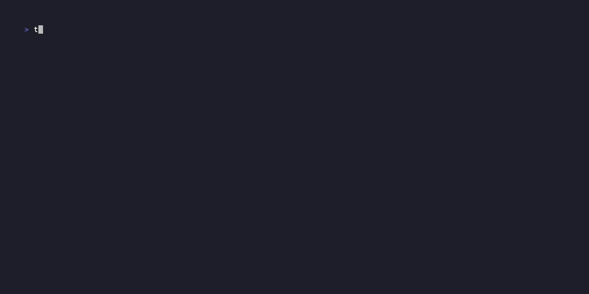

# themeset

**One command to coordinate native themes across your terminal tools.**

Use existing application themes and official ports instead of generating approximate palettes.



## Highlights

- Interactive theme picker with native previews and GitHub Stars ranking.
- Dry-run plans and explicit confirmation before changing configuration.
- Native, official, and custom theme sources with per-tool fallback.
- Preserves unrelated application settings; skips unsupported tools.
- Bash, Zsh, and Fish completions.

## Install

```sh
brew install clang-engineer/tap/themeset
```

Homebrew supports macOS and Linux (arm64/amd64). See the [manual](docs/manual.md#install) for source builds and platform limitations.

## Quick start

```sh
themeset list
themeset apply
themeset apply dracula --dry-run
themeset apply dracula
themeset current
```

Supported tools include Ghostty, Neovim, tmux, fzf, bat, Delta, Starship, Yazi, Atuin, lazygit, lazydocker, btop, eza, and Harlequin. Availability depends on the selected theme and installed applications.

For fzf, see the [activation instructions](docs/manual.md#fzf-activation). Third-party tmux plugins may execute upstream shell code; review the [trust and activation notes](docs/manual.md#tmux-plugins-and-reload).

## Documentation

- [Full manual](docs/manual.md) — commands, configuration, completion, fallback, and releases.
- [Adapter lifecycle](theme-adapters.md) — supported integrations and implementation details.
- [Demo recording](docs/demo.tape)

## License

MIT. See [third-party notices](THIRD_PARTY_NOTICES.md).
